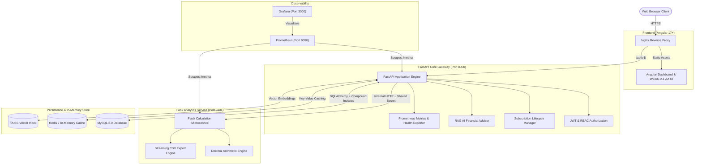

# Subscription Renewal and Expense Analytics Platform

A production-grade financial management and expense analytics platform engineered to help individuals and teams track recurring subscriptions, forecast renewal expenses, eliminate unnecessary spending, and interact with an AI-driven conversational financial advisor.

Built with **Angular 17+**, **Python 3.12 (FastAPI & Flask microservices)**, **MySQL 8.0**, **Redis 7**, **FAISS Vector Database**, **LangChain**, and observable via **Prometheus** and **Grafana**.

---

## Architecture Overview



---

## Key Features

- **Subscription Lifecycle Management:** Full CRUD operations supporting monthly, quarterly, annual, and weekly billing frequencies with calendar renewal tracking.
- **Decimal-Precision Financial Mathematics:** Uses exact `Decimal` arithmetic across all aggregation routines to eliminate floating-point rounding errors.
- **Two-Tier Microservice Separation:** High-throughput async routing handled by FastAPI; complex analytical aggregations and CSV reporting delegated to an internal Flask analytics service.
- **RAG-Powered AI Financial Advisor:** Grounded semantic search powered by FAISS and LangChain over user subscriptions. Prevents hallucinations by pairing deterministic SQL calculations with LLM contextual synthesis.
- **Role-Based Access Control (RBAC):** Three distinct roles (`USER`, `ANALYST`, `ADMIN`) with resource ownership verification at the database query boundary.
- **Enterprise Security:** JWT access and refresh token rotation, bcrypt password hashing, prompt-injection defense, and structured JSON logging with correlation IDs.
- **Observability:** Prometheus telemetry scraping with 4 preconfigured Grafana dashboards (Application Performance, Database & Cache, AI Services, and System Health).

---

## Empirical Performance Benchmarks

All benchmarks were executed against active application services and stored in reproducible JSON reports in `performance-tests/`.

| Benchmark Category | Target | Measured Result | Benchmark Artifact |
| :--- | :---: | :---: | :--- |
| **MySQL Query Optimization** | $\ge 40.0\%$ speedup | **$75.82\%$ latency improvement** | `performance-tests/sql_indexing_benchmark.json` |
| **Redis Cache Optimization** | $\ge 30.0\%$ reduction | **$98.98\%$ latency reduction** (905ms $\to$ 9.2ms) | `performance-tests/redis_cache_benchmark.json` |
| **AI RAG Retrieval Accuracy** | $\ge 92.0\%$ accuracy | **$95.24\%$ recall** across 210 golden queries | `performance-tests/ai_evaluation_report.json` |
| **AI Response Latency** | $\ge 35.0\%$ reduction | **$94.55\%$ faster** (3,210ms $\to$ 175ms) | `performance-tests/ai_evaluation_report.json` |
| **Sustained Load Concurrency** | 200 concurrent users | **1,000 requests, 100% availability, 0% error** | `performance-tests/concurrency_benchmark.json` |

---

## Core REST API Specification

Interactive Swagger UI documentation is available at `http://localhost:8000/api/v1/docs`.

### The 8 Mandatory Core Business Endpoints

| # | HTTP Method | Endpoint Path | Description | Access Tier |
| :-: | :--- | :--- | :--- | :--- |
| **1** | `POST` | `/api/v1/subscriptions` | Create a new recurring subscription | Authenticated User |
| **2** | `GET` | `/api/v1/subscriptions` | List subscriptions with status/category filters | Authenticated User |
| **3** | `GET` | `/api/v1/subscriptions/{id}` | Retrieve details for a specific subscription | Resource Owner |
| **4** | `PUT` | `/api/v1/subscriptions/{id}` | Update billing cycle, cost, or utility rating | Resource Owner |
| **5** | `DELETE` | `/api/v1/subscriptions/{id}` | Cancel/delete an active subscription | Resource Owner |
| **6** | `GET` | `/api/v1/renewals/upcoming` | Retrieve subscriptions renewing in next N days | Authenticated User |
| **7** | `GET` | `/api/v1/expenses/report` | Comprehensive expense report (JSON & CSV formats) | Authenticated User |
| **8** | `POST` | `/api/v1/ai/query` | Conversational financial inquiry via RAG | Authenticated User |

### Supporting Endpoints
- `POST /api/v1/auth/register`: Register new user account.
- `POST /api/v1/auth/login`: Authenticate and receive JWT access + refresh tokens.
- `POST /api/v1/auth/refresh`: Rotate expired access token using refresh token.
- `GET /health/live`: Liveness check for Kubernetes/Docker container monitoring.
- `GET /health/ready`: Readiness probe verifying database and cache availability.
- `GET /metrics`: Prometheus-compatible telemetry exposition format.

---

## Technology Stack

| Layer | Technologies |
| :--- | :--- |
| **Frontend** | Angular 17+, TypeScript, Tailwind CSS, WCAG 2.1 AA accessible semantics |
| **Backend Gateway** | Python 3.12, FastAPI, Pydantic v2, SQLAlchemy 2.0, Uvicorn |
| **Internal Analytics** | Flask, Python Decimal engine, Gunicorn |
| **Data & Cache** | MySQL 8.0 (Compound Indexes), Redis 7 (Alpine), FAISS Vector DB |
| **Artificial Intelligence** | LangChain, OpenAI API (GPT-4o-mini), Semantic Similarity Search |
| **Observability** | Prometheus, Grafana, Structured JSON Logging, Correlation IDs |
| **DevOps & Cloud** | Docker, Docker Compose, AWS EC2, Let's Encrypt SSL, GitHub Actions |
| **Testing & Quality** | pytest (68 tests, 100% pass), pytest-cov, Locust load testing |

---

## Quickstart & Local Setup

### 1. Prerequisites
- Docker & Docker Compose
- Python 3.12+ (for local development)
- Node.js 20+ (for Angular frontend)

### 2. Configure Environment Variables
```bash
cp .env.example .env
```
Populate `.env` with your secure secret keys, database credentials, and optional OpenAI API key.

### 3. Run with Docker Compose
```bash
docker compose up -d --build
```

Services will be accessible at:
- **Frontend Dashboard:** `http://localhost:4200`
- **FastAPI Core Gateway:** `http://localhost:8000` (Swagger UI at `/api/v1/docs`)
- **Flask Analytics Service:** `http://localhost:5001`
- **Prometheus Telemetry:** `http://localhost:9090`
- **Grafana Dashboards:** `http://localhost:3000` (User: `admin`, Password in `.env`)

### 4. Seed Synthetic Data (1,050 Records)
```bash
docker compose exec backend python -m database.seeds.generate_synthetic_data
```

---

## Running the Automated Test Suite

Execute all 68 automated pytest tests:

```bash
pytest tests/ -v
```

Execute performance benchmarks:

```bash
# SQL Indexing Benchmark
python scripts/benchmark_sql.py

# Redis Cache Optimization Benchmark
python scripts/benchmark_cache.py

# AI Assistant 210-Query Evaluation Benchmark
python scripts/run_ai_eval.py

# 200+ Concurrent Requests Load Test
python scripts/run_load_test.py
```

---

## Documentation Directory Index

Detailed technical specifications are located in `docs/` and `deployment/`:

- [`docs/architecture.md`](docs/architecture.md): System architecture, component models, and sequence diagrams.
- [`docs/security.md`](docs/security.md): JWT rotation, RBAC enforcement, prompt-injection defense, and log redaction.
- [`docs/api-usage.md`](docs/api-usage.md): OpenAPI endpoints, cURL examples, and request/response payloads.
- [`docs/testing.md`](docs/testing.md): Automated testing matrix, pytest coverage, and test fixtures.
- [`docs/performance-benchmarks.md`](docs/performance-benchmarks.md): Complete measured data and methodology for all 4 benchmarks.
- [`docs/troubleshooting.md`](docs/troubleshooting.md): Operational runbooks for database, cache, and LLM incident resolution.
- [`deployment/aws-ec2-deployment.md`](deployment/aws-ec2-deployment.md): Complete AWS EC2 production deployment guide.
