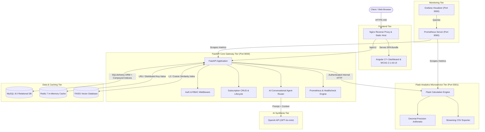
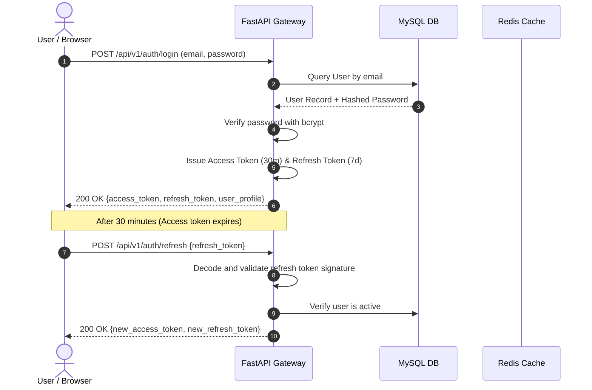
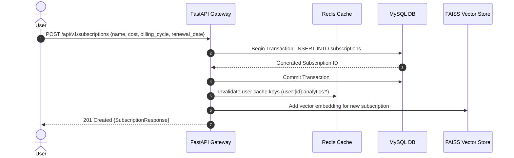
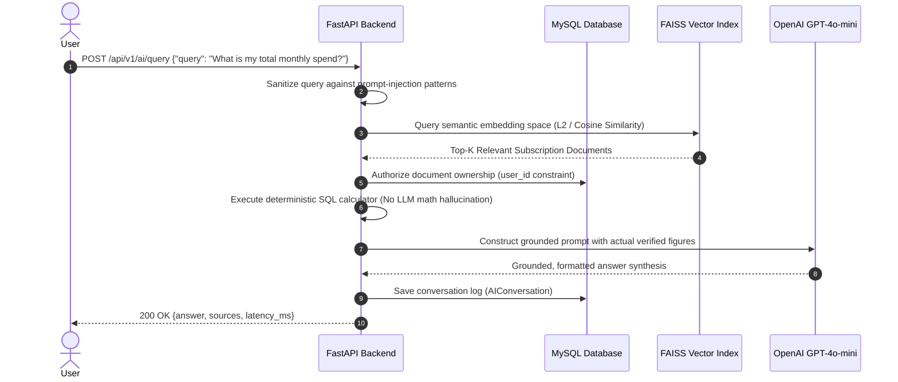
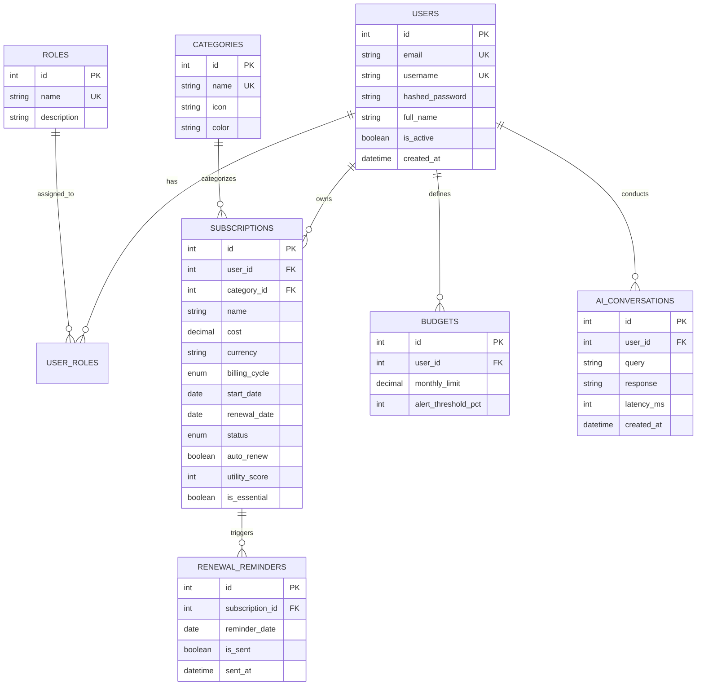

# Platform Architecture & Design Documentation

## 1. System Overview

The **Subscription Renewal and Expense Analytics Platform** is structured as a decoupled, multi-service architecture designed for high throughput, sub-millisecond cache hits, deterministic financial precision, and contextual AI-driven insights.

---

## 2. Sequence Diagrams

### 2.1 User Authentication & Token Refresh Flow

### 2.2 Subscription CRUD & Cache Invalidation

### 2.3 Grounded RAG AI Assistant Execution

---

## 3. Database Entity Relationship (ER) Model

