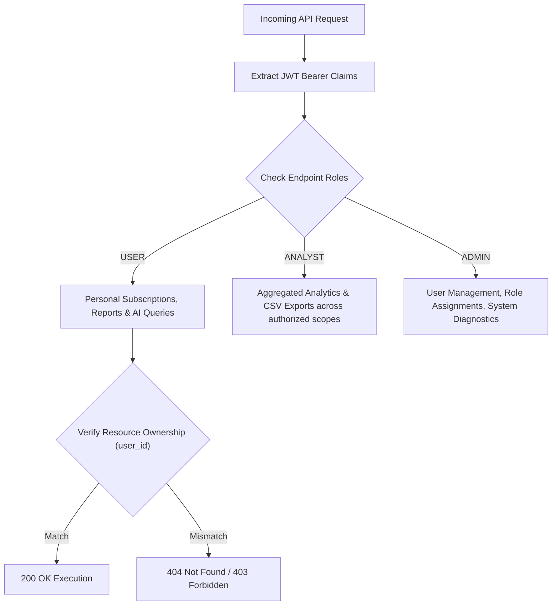

# Security Architecture & Implementation Guide

The **Subscription Renewal and Expense Analytics Platform** incorporates enterprise security standards across every tier of the application stack.

---

## 1. Authentication & Token Management

- **Dual-Token Architecture:**
  - **Access Tokens:** Signed with HMAC-SHA256 (`HS256`), containing standard claims (`sub`, `exp`, `iat`, `type="access"`, `roles`). Short lifespan of **30 minutes**.
  - **Refresh Tokens:** High-entropy signed tokens with lifespan of **7 days** (`type="refresh"`). Used exclusively at `POST /api/v1/auth/refresh` for silent token renewal.
- **Password Security:**
  - Passwords are hashed using the battle-tested `bcrypt` algorithm with automated salting and work factor calibration. Plaintext passwords are never logged, stored, or transferred unencrypted.
- **Revocation & Logout:**
  - `POST /api/v1/auth/logout` explicitly invalidates the active bearer token in Redis with a TTL equal to the remaining token lifetime.

---

## 2. Role-Based Access Control (RBAC)

The application enforces three distinct authorization tiers using FastAPI's dependency injection system:

- **`USER`**: Can only view and mutate their own subscriptions, budgets, and AI assistant queries. Accessing another user's `subscription_id` strictly aborts with `404 Not Found` (to avoid ID enumeration attacks).
- **`ANALYST`**: Authorized to query aggregated multi-category reporting endpoints and financial redundancy analytics.
- **`ADMIN`**: Granted access to `/api/v1/admin/users`, `/api/v1/admin/operations`, user activation/deactivation, and role modifications.

---

## 3. Data Protection & Defense-in-Depth

### 3.1 SQL Injection Protection
- All database operations are mediated by **SQLAlchemy 2.0 ORM** using parameterized bound variables.
- Direct string formatting inside SQL clauses is strictly prohibited across the codebase.

### 3.2 Input Validation with Pydantic v2
- Every inbound request payload is strongly validated against Pydantic schemas before reaching business logic controllers.
- Validations include:
  - Monetary values: `Decimal` types with non-negative constraints (`gt=0`, `decimal_places=2`).
  - Enum validation: Strict matching against defined cycles (`MONTHLY`, `ANNUAL`, `QUARTERLY`, `WEEKLY`).
  - String sanitization: Maximum lengths on names, descriptions, and user inputs to mitigate buffer overruns and memory flooding.

### 3.3 Prompt-Injection Mitigation
Financial conversational interfaces are susceptible to malicious prompt injection. We implement a multi-layered barrier:
1. **Input Sanitization:** Strips delimiter overrides (e.g., `---`, `### System:`, `[INST]`, `<|im_start|>`).
2. **Deterministic Pre-Execution:** Financial totals are calculated via SQL aggregations in Python—never synthesized by LLM arithmetic.
3. **Strict Context Enclosure:** Verified financial records are injected into immutable XML/JSON boundaries in the system prompt.
4. **Behavioral Guardrails:** System instructions explicitly restrict the model to personal finance guidance and refuse arbitrary command execution.

### 3.4 Cross-Origin Resource Sharing (CORS) & Security Headers
- Nginx injects modern security headers on all responses:
  - `Strict-Transport-Security: max-age=63072000; includeSubDomains; preload`
  - `X-Content-Type-Options: nosniff`
  - `X-Frame-Options: DENY`
  - `X-XSS-Protection: 1; mode=block`
  - `Referrer-Policy: strict-origin-when-cross-origin`
- CORS is restricted to explicit trusted origins specified in `BACKEND_CORS_ORIGINS`.

---

## 4. Sensitive Data Handling & Log Redaction

- Application logs pass through a structured JSON formatter with sensitive field redaction.
- Authorization headers (`Bearer ey...`), password fields, API keys, and credit card substrings (`****4242`) are scrubbed before writing to stdout.
